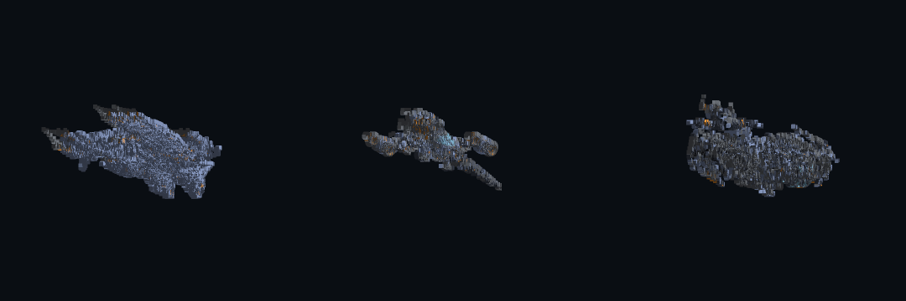
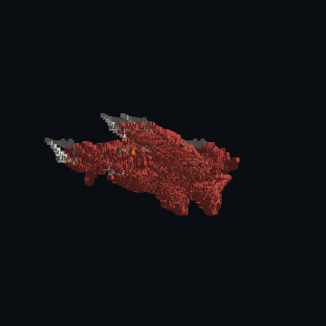

# starforge

**无人深空（No Man's Sky）飞船与星球情报台** —— 搜种子、看真 3D、找星球、把符文举到你眼前。
本地运行，不改游戏文件，默认只读；写入前自动备份。


---

## 它能做什么

| 能力 | 状态 |
|---|---|
| 按部件 / 涂装条件搜索飞船种子（同型内） | ✅ 网页可用（13–20 M seeds/s） |
| 真 3D 预览（读你自己的游戏 pak）+ 浏览器内可旋转 | ✅ WebGL 查看器 + 导出 glb |
| 服务端渲染缩略图（点云 + 法线着色 + 2× 超采样） | ✅ 网格与详情页共用 |
| 存档飞船图鉴（型号 / 种子 / 名称 / 是否可换外观） | ✅ 真实存档验证（7/8 艘） |
| 星系 / 星球搜索（生物群系、哨兵、dissonant） | ✅ 实测 25 系统/秒级 |
| 本星系船池（含拦截机种子） | ✅ 实测 50 条/系统 |
| **传送门符文**（地址 → 12 个符文，网页浮层/弹窗） | ✅ 网页版可用；独立置顶窗口 🚧 |
| 同型换种子写回存档（备份 + 原子写 + 读回 + 回滚） | ✅ 已实现并测试（跨型明确拒绝） |
| 游戏内实时通道（模板槽写 seed，仅 Windows，默认关闭） | ✅ 定位/写入/回读已实现；模板 Mod 一键生成 |

**实时通道（可选）**：只写 8 字节种子到"模板槽"，不碰你的船；定位靠出厂种子 + `Slots` 结构自洽，
多个候选同样可信时**拒绝写入**；写后立刻回读校验。仅 Windows，默认关闭，需显式确认。

**明确不做**：跨型移植外观（`seed` 与 `type` 绑定，物理不可行）、修改玩家资产、多人模式写入、注入修改游戏代码。

---

## 为什么是"符文浮窗"而不是"一键传送"

传送必须进程内调用引擎，版本一更新就失效、还可能崩；而**传送门符文就是系统地址的 12 位十六进制**——
游戏内的符文图标资源就在 `NMSARC.TexUI.pak` 的 `textures/ui/frontend/icons/update3/portalsymbol.<0-f>.dds`（16 张，BC7）。
starforge 把该输的 12 个符文放大置顶显示，你照着传送门点即可：**零注入、零风险、效果一样**。

---

## 效果



> 左：拦截机（sentinel）· 中：战斗机（fighter）· 右：运输舰（hauler）。浏览器里是可旋转的真 3D（WebGL），这张是服务端渲染的兜底图。

传送门符文直接取自游戏（`textures/ui/frontend/icons/update3/portalsymbol.*.dds`，BC7 解码）：


同一艘船，按种子的真实配色渲染：



## 桌面应用（默认形态）

双击 `starforge.exe` 会打开一个**原生窗口**（Windows 上用 Edge WebView2 渲染；双击时会自动隐藏黑控制台，也不需要装 Python）：

- 路径全部自动检测；设置页有「浏览…」原生目录选择框，不用手打
- 数据层已内置（NMS-Shipwright, MIT），**不需要额外安装任何东西**
- 没有 Gagarin 数据也能用：部件树从游戏 pak 自己推导
- 3D 用**种子真实配色**渲染（从游戏数据解出主色/副色/底漆）

> 命令行：单 exe 版本用 `starforge.exe <子命令>`；v0.11.x 的包里是 `starforge-cli\starforge-cli.exe <子命令>`。
> 可用子命令：`serve`（浏览器调试）、`ships`、`selfcheck`、`webcheck`、`glyph-overlay`、`live probe`。

## 快速开始

```bash
git clone https://github.com/MaroD1M/starforge.git
cd starforge
pip install -r requirements.txt

# 告诉它依赖的算法库与数据目录（见下）
export STARFORGE_SHIPWRIGHT=/path/to/NMS-Shipwright
export STARFORGE_GAMEDATA=/path/to/NoMansSky/GAMEDATA

python -m starforge selftest     # 自检：上游 / 数据 / 存档 / 游戏
python -m starforge serve        # 打开本地网页（127.0.0.1，随机端口）
```

**一条命令自检**（写入只在存档副本上发生）：

```bash
python -m starforge selfcheck
# ✓ 部件目录  ✓ 读存档  ✓ 搜索  ✓ 3D+glb  ✓ 缩略图  ✓ 符文  ✓ 星系  ✓ 写入(副本)  ✓ 实时通道状态
```

常用命令：

```bash
python -m starforge ships --path save.hg      # 列存档里的船
python -m starforge glyph-overlay 1043FEE69929 --click-through   # 符文置顶条
python -m starforge live probe                # 只读探测模板槽（Windows）
```

`STARFORGE_HOME`（默认 `~/.starforge`）存放设置、日志与缓存，可整目录删。

---

## 依赖与架构

starforge **不重复造轮子**，而是把三个开源项目缝成一个产品：

| 组件 | 提供 | 我们补什么 |
|---|---|---|
| [NMS-Shipwright](https://github.com/S-T-0-7/NMS-Shipwright) | 种子生成算法、几何/涂装、存档读写、系统生成 | 任务化、缓存、降级、UI |
| [Gagarin_Titov](https://github.com/autoeme/Gagarin_Titov) | 部件目录 `catalog.txt`、真实缩略图 `icons.bin` | 解码、索引、HTTP |
| [NMS-Super-Ship-Hunter](https://github.com/beihaixingchen/NMS-Super-Ship-Hunter) | "模板槽 + 外部写"的游戏内落地思路 | 容错签名、8 槽 EXML、回读校验 |

本仓库**不包含**任何上游二进制、游戏文件或存档；只包含我们自己的代码与文档。

---

## 界面（设计稿）

五页：搜索 / 我的船 / 星球 / 设置 + 独立符文浮窗。
文档：[使用指南](docs/USAGE.md)（逐屏）· [软件手册](docs/MANUAL.md) · [设计方案](docs/DESIGN.md) ·
[能力清单](docs/CAPABILITIES.md) · [Windows 验收清单](docs/VERIFY-WINDOWS.md)。

---

## 首次启动会自动找路径

starforge 会尝试自动发现：游戏目录（`NMS_DIR` → Steam/GOG → 注册表）、存档目录
（`%APPDATA%\HelloGames\NMS\st_*`）、数据目录。找不到时在设置页点「自动检测路径」或手填。

## 为什么杀毒软件可能报警

starforge 会读游戏内存（可选的实时通道）并修改你自己的存档文件，这两件事都是杀软启发式的重点：

- **只在你点「送进游戏」时才读内存**，且只写 8 字节种子到模板槽；
- 存档写入前自动备份、写后读回、失败回滚；
- 不联网（除你主动点检查更新）、不驻留后台、不开机自启。

如果你不放心：不要打开「允许写入」，只用搜索/预览/星球/符文——这些完全离线且不碰游戏进程。
发布包的哈希在 Release 页面，可自行核对。

## 安全

* 只监听 `127.0.0.1`，校验 `Host`/`Origin`（防 CSRF / DNS rebinding）。
* 写入默认关闭；开启后仍需二次确认；写前备份、写后读回、失败回滚。
* 覆盖层是**独立置顶窗口**，不注入游戏进程；请把游戏设为"无边框窗口"模式。
* 不联网（除你主动点"检查更新"）。

---

## 许可与致谢

本项目 **MIT**（见 [LICENSE](LICENSE)）。

致谢并遵守上游许可：
* **NMS-Shipwright** —— 生成算法与存档层（按其许可使用，未内置其代码副本）。
* **Gagarin_Titov** —— 部件目录与图标数据（其数据文件由用户本地游戏目录提供；字体 NMS Futura Pro Book 为 SIL OFL 1.1）。
* **NMS-Super-Ship-Hunter** —— (MIT) 游戏内外部写入思路。
* **Dear ImGui / numpy / Flask / hgpaktool** 等开源项目。

> 非官方项目，与 Hello Games 无关。修改存档有风险，请先备份；仅在单机使用。
